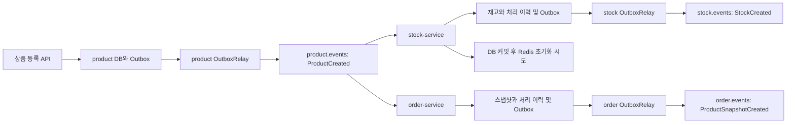

# 이벤트 흐름과 계약

## 전체 흐름

stock과 order는 독립적으로 같은 상품 생성 이벤트를 받는다. 두 처리 사이의 선후 관계는 보장하지 않는다.
notification은 `notification-service` 그룹으로 모든 `*.events`를 별도로 소비해 로그로 남긴다.
현재 `StockCreated`와 `ProductSnapshotCreated`를 모아서 상품 준비 완료를 판정하는 기능은 없다.

## 발행 계약

| 이벤트 타입 | 발행 서비스와 토픽 | JSON 본문 필드 | Kafka key |
|---|---|---|---|
| `ProductCreated` | product, `product.events` | `productId: Long`, `name: String`, `price: long` | 상품 ID 문자열 |
| `StockCreated` | stock, `stock.events` | `productId: Long`, `quantity: int` | 상품 ID 문자열 |
| `ProductSnapshotCreated` | order, `order.events` | `productId: Long`, `name: String`, `price: long` | 상품 ID 문자열 |

가격은 원 단위 정수다. `StockCreated`의 초기 수량은 0이다.
본문 record는 [common 메시지 패키지](../../common/src/main/java/com/eda/common/message)에 둔다.
엔티티 전체나 메시지 wrapper를 JSON 본문으로 보내지 않는다.

공통 헤더는 `messageId`(UUID 문자열), `messageType`(record 클래스의 단순 이름), `occurredAt`(Instant 문자열)이다.
메시지 타입의 클래스 이름은 패키지가 달라도 중복하지 않는다.
`occurredAt`은 Outbox 기록 시 생성하는 이벤트 시각이며 DB 커밋 시각이나 소비 완료 시각이 아니다.
입력 메시지와 후속 이벤트는 서로 다른 UUID를 가진다. 현재 별도 인과관계 헤더는 없다.

## 소비 계약

| 소비 서비스 | 토픽과 그룹 | 처리할 타입 | 실패 보관 토픽 |
|---|---|---|---|
| stock | `product.events`, `stock-service` | `ProductCreated` | `stock.product.events.DLT` |
| order | `product.events`, `order-service` | `ProductCreated` | `order.product.events.DLT` |

- key와 value를 문자열로 읽고, 타입 확인 후 `Message.from()`으로 변환한다. 다른 타입은 건너뛴다.
- 두 소비자는 서비스의 DB 트랜잭션을 동기 호출한다. `enable-auto-commit=false`, `ack-mode=batch`이며 리스너는 한 건씩 호출된다.
- `auto-offset-reset=earliest`는 유효한 커밋 위치가 없는 그룹에 적용된다. 매 재시작마다 처음부터 읽는 설정이 아니다.
- DB와 Outbox 저장 실패는 최초 시도 후 1초 간격으로 3회 재시도한다. 계속 실패하면 해당 서비스의 DLT로 보낸다.
- 메시지 형식과 필수 입력 오류는 `InvalidProductEventException`으로 처리하고 바로 DLT로 보낸다.
- DLT는 원본 key와 본문 및 이벤트 헤더, 오류 정보를 보존한다. 목적지 파티션은 producer가 선택한다.
- DLT 발행 결과까지 확인한다. 발행에 실패하면 원본을 건너뛰지 않고 다시 처리한다.

메시지 중복과 ACK의 근거는 [멱등 처리 결정](../adr/0002-consumer-idempotency.md)과
[실패 처리 결정](../adr/0003-kafka-consumer-recovery.md)에 정리했다.
DLT로 보냈다는 사실은 업무 처리 성공을 의미하지 않는다. 조회와 재처리 API는 아직 없다.

## 완료와 순서의 의미

상품 등록의 201 응답은 product DB와 Outbox 커밋을 의미한다.
후속 이벤트도 각 서비스 DB의 생성 사실만 알린다. 다른 서비스나 Redis의 준비 완료를 보장하지 않는다.
stock의 Relay 발행과 Redis 초기화 사이에도 순서 보장이 없다.
Kafka key는 동일 상품의 파티션 선택에 사용하지만, 여러 서비스의 DB 커밋을 하나로 묶거나 전역 순서를 만드는 수단은 아니다.
Relay와 DLT 모두 재발행 가능성이 있으므로 실제 부수 효과를 만드는 소비자는 멱등 처리가 필요하다.
