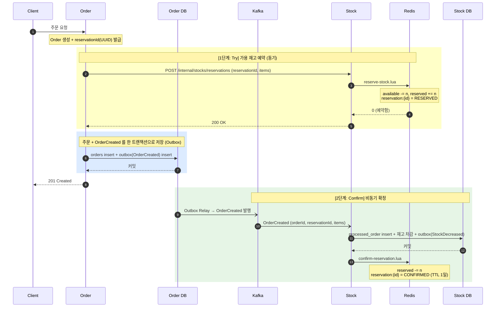
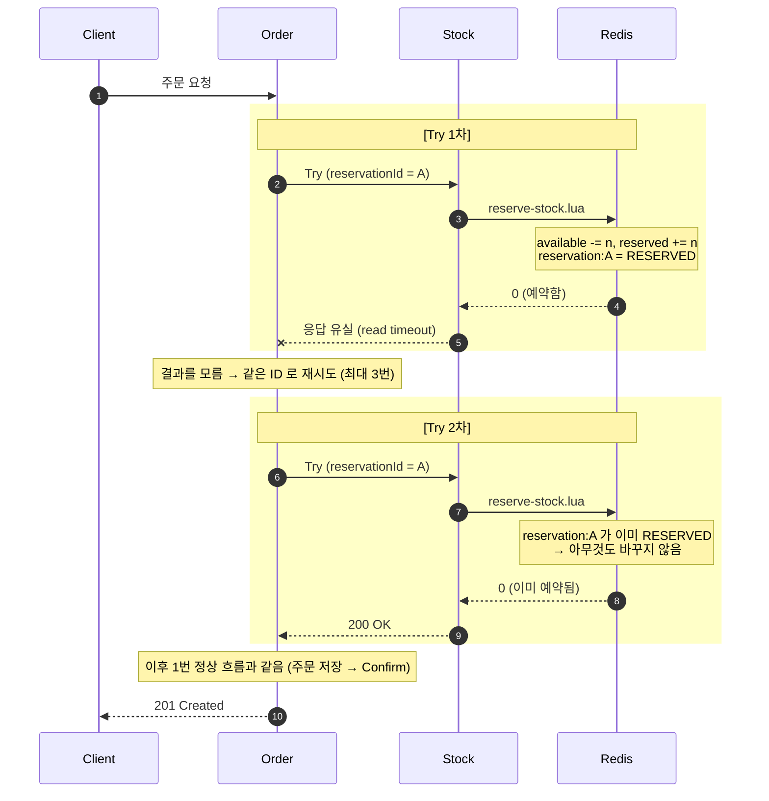
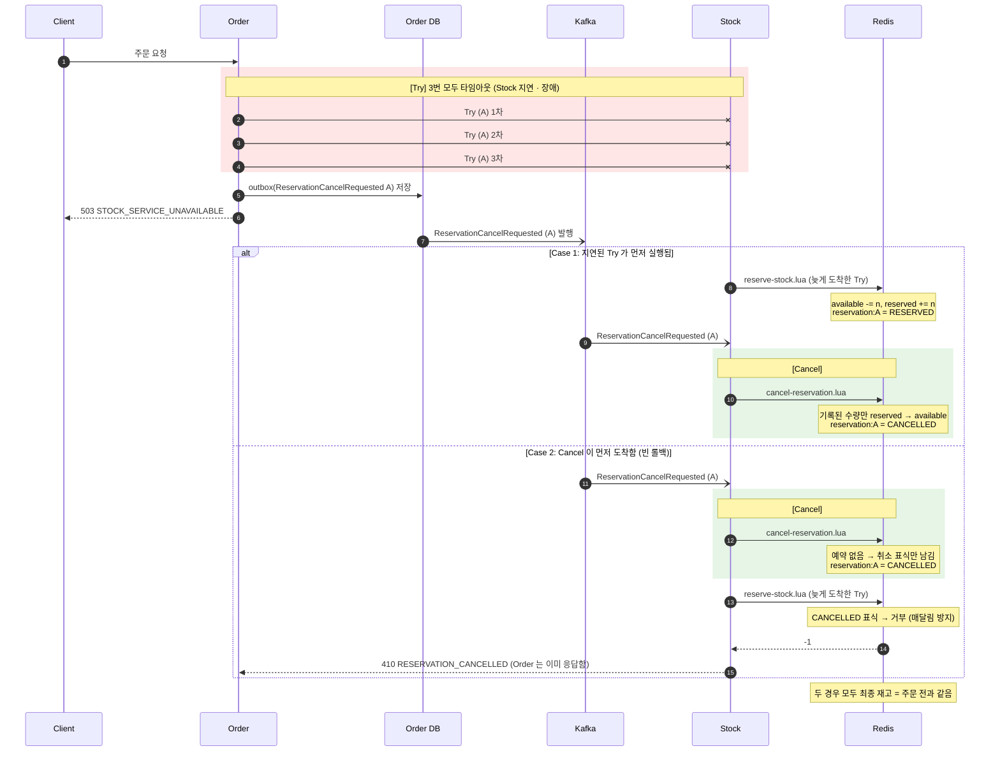
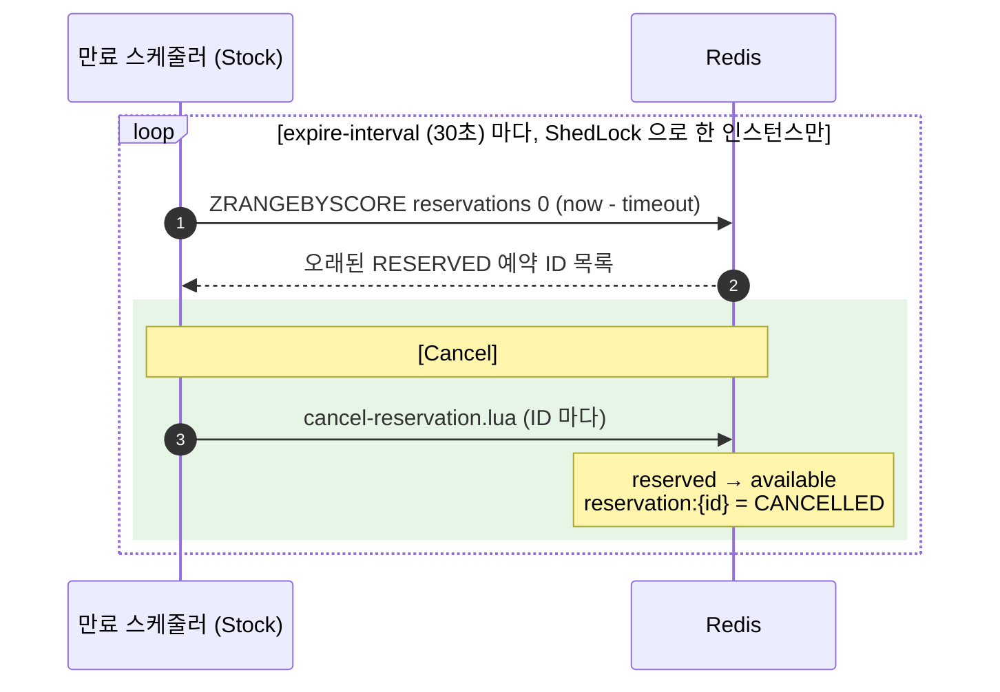

# 재고 예약 TCC

주문 시 재고를 동기로 차감할 때, 네트워크 오류로 **재고 처리 여부를 알 수 없는 상황**에서도 재고가 새거나(과소 판매) 두 번 빠지지(과대 판매) 않도록 TCC(Try-Confirm-Cancel)로 재고를 예약한다.

| 단계 | 호출 | 하는 일 |
|------|------|---------|
| Try | order → stock `POST /internal/stocks/reservations` (동기) | Redis `available` → `reserved`, `reservation:{id}` 에 상품별 수량 기록 |
| Confirm | `OrderCreated` 이벤트 (outbox → Kafka) | Stock DB 차감 커밋 후 Redis `reserved` 에서 뺌 |
| Cancel | `ReservationCancelRequested` 이벤트 · cancel API · 만료 스케줄러 | 기록된 수량만 `reserved` → `available` |

핵심 규칙

- **멱등**: 모든 단계는 order 가 만든 `reservationId` 로 한 번만 반영된다. 그래서 결과를 모르면 같은 ID 로 다시 보내 확인할 수 있다
- **빈 롤백**: Try 보다 Cancel 이 먼저 오면 `CANCELLED` 표식만 남긴다
- **매달림 방지**: `CANCELLED` 표식이 있는 ID 의 Try 는 거부한다 (Cancel 뒤에 늦게 도착한 Try 차단)
- **안전망**: `stock.reservation.timeout` (기본 10분) 넘게 남은 예약은 만료 스케줄러가 취소한다

---

## 1. 정상 흐름

---

## 2. Try 결과를 모름 → 같은 ID 로 재시도해서 확인

Redis 차감은 성공했는데 응답이 유실된 경우. 재시도해도 멱등하므로 한 번만 차감된다.

---

## 3. 재시도까지 모두 실패 → Cancel

결과를 끝내 모르면 주문은 실패시키고, 예약이 늦게라도 실행될 수 있으므로 반드시 Cancel 한다. Try 와 Cancel 중 무엇이 먼저 도착해도 재고는 새지 않는다.

주문 저장(DB)이 실패한 경우도 같은 방식으로 Cancel 한다. outbox 저장마저 실패하면 cancel API 를 직접 호출하고, 그것도 실패하면 4번의 만료 스케줄러가 처리한다.

---

## 4. 안전망 — 만료 스케줄러

Cancel 요청까지 유실돼 예약이 남은 경우.

> `OrderCreated` 가 timeout 보다 늦게 도착하면, 예약이 먼저 취소된 뒤 DB 만 차감된다. Confirm 이 이를 `error` 로그로 남기고 대사 스케줄러가 Redis 를 DB 에 맞춘다. timeout 은 Kafka 지연보다 충분히 길게 잡는다.

---

## 장애 시나리오별 결과

| 장애 지점 | 처리 | 최종 재고 |
|-----------|------|-----------|
| Stock → Redis 요청 전 실패 | Try 재시도 → 성공하면 주문 성공, 끝까지 실패하면 Cancel (빈 롤백) | 정상 |
| Redis 차감 후 Stock 응답 유실 | 같은 ID 로 재시도 → `이미 예약됨` → 주문 성공 | 한 번만 차감 |
| Stock → Order 응답 유실 | 위와 같음 | 한 번만 차감 |
| 재시도 3번 모두 결과 모름 | 주문 실패 + Cancel 이벤트 | 복원 |
| 주문 저장 실패 | Cancel 이벤트 (실패 시 cancel API 직접 호출) | 복원 |
| Cancel 까지 유실 | 만료 스케줄러가 Cancel | 복원 (timeout 뒤) |
| Cancel 뒤 지연된 Try 도착 | 취소 표식으로 거부 | 정상 |
| Order → Client 응답 유실 | **미처리** — 클라이언트 재시도 시 주문 중복 (`Idempotency-Key` 필요) | 중복 차감 |

## 테스트

| 대상 | 테스트 |
|------|--------|
| Lua 스크립트 (Testcontainers Valkey) — 전부 또는 전무 · 동시 100건 중 10건 · 멱등 · 빈 롤백 · 매달림 방지 | `stock/.../infrastructure/StockRedisRepositoryTest` |
| Try 결과 코드 → 예외 변환 | `stock/.../application/StockServiceReservationTest` |
| Stock DB 차감 · 중복 이벤트 한 번만 차감 · 실패 시 롤백 | `stock/.../application/StockServiceOrderDecreaseTest` |
| 주문 이벤트 → DB 차감 후 Confirm, 취소 이벤트 → Cancel | `stock/.../event/OrderEventListenerTest` |
| 주문 생성 코디네이터 — 저장 · 취소 요청 판단 | `order/.../application/OrderServiceTest`, `OrderServiceCancelFallbackTest` |
| Try 재시도 판단 | `order/.../infrastructure/StockClientTest` |
| 요청 검증 · 에러 응답 | `order/.../api/OrderControllerTest`, `stock/.../api/InternalStockControllerTest` |

## 관련 코드

| 역할 | 위치 |
|------|------|
| TCC 코디네이터 | `order/.../application/OrderService.java` |
| Try 재시도 · Cancel 호출 | `order/.../infrastructure/StockClient.java` |
| Try · Cancel API | `stock/.../api/InternalStockController.java` |
| Confirm · Cancel 이벤트 수신 | `stock/.../event/OrderEventListener.java` |
| 만료 스케줄러 | `stock/.../application/StockReservationExpirer.java` |
| Lua | `stock/src/main/resources/redis/{reserve-stock,confirm-reservation,cancel-reservation}.lua` |
